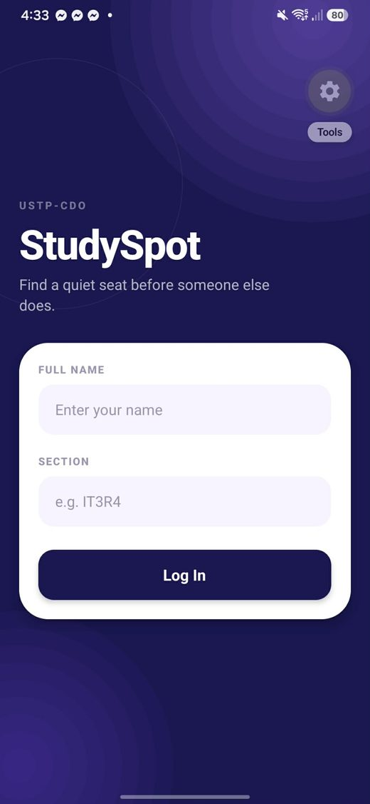
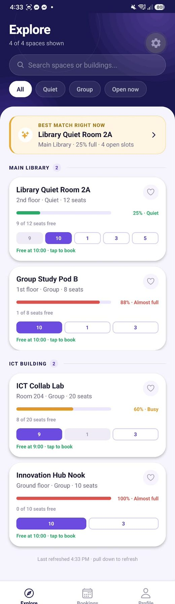
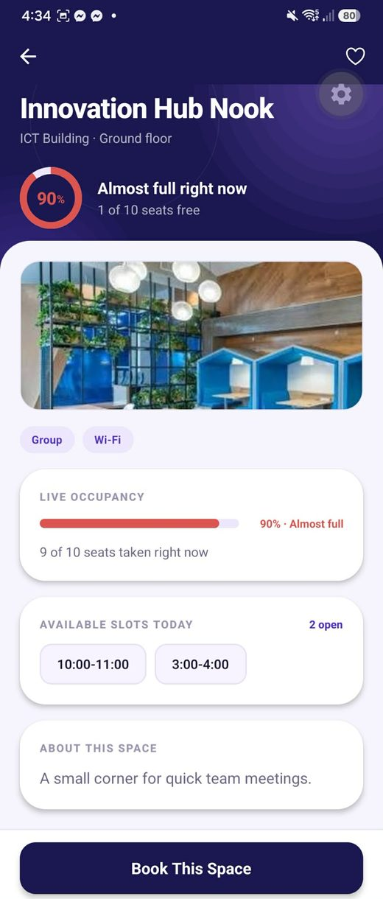
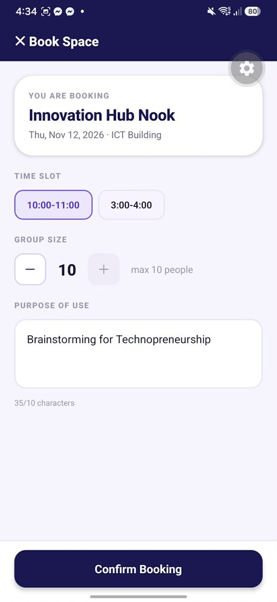
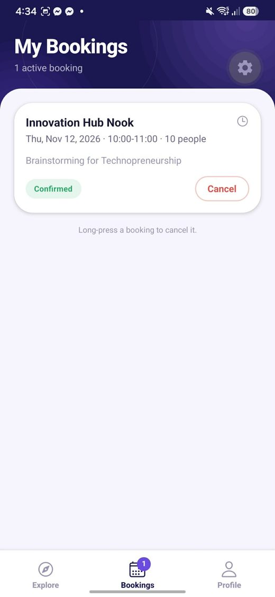
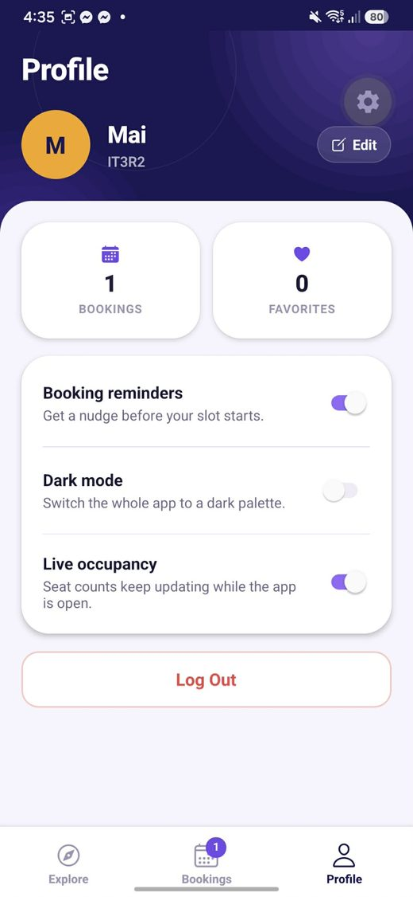
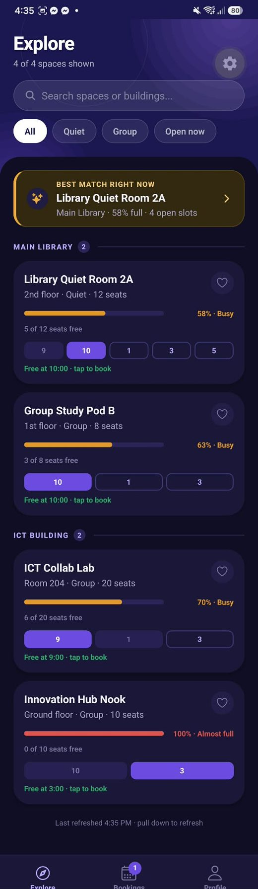
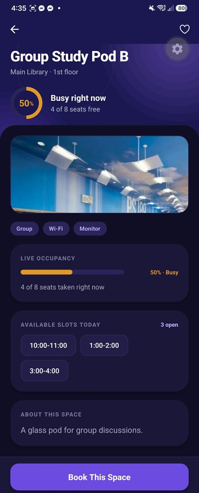
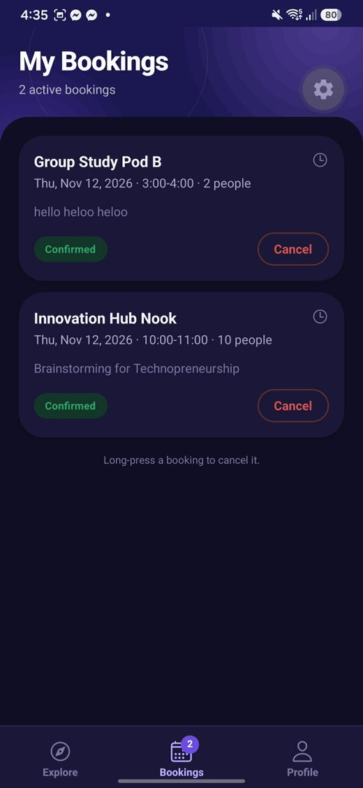
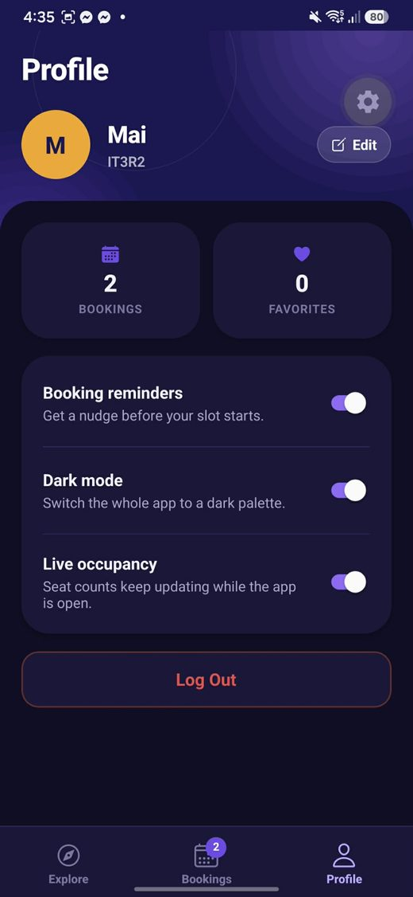

# StudySpot

**IT 313 – Mobile Programming · Performance Task (Modules 6–9)**
Maira Lorraine Domaog · USTP-CDO

A campus study-space finder and booking app built with Expo, React Native and
TypeScript. Students sign in, browse study spaces grouped by building, see how
full each one is, open its details, and reserve a time slot.

All data lives in memory. Sign-in is simulated. There is no backend or database.

---

## 1. The problem

Finding a quiet, free place to study on campus wastes time every single day.
You walk to the library, the quiet room is full, you walk to the ICT building,
the collab lab is taken. There is no way to know before you go.

StudySpot answers three questions without leaving your seat:

1. **Where is there space right now?** Every card shows a live occupancy bar
   that is green, amber or red depending on how full the room is.
2. **If not now, when?** Each card carries a strip of the whole day, so you can
   see at a glance which hours are still open.
3. **Which one should I pick?** A "Best match right now" banner recommends one
   space using a rule the app computes, not a hard-coded answer.

---

## 2. Running it

```bash
npm install
npx expo start
```

Then press `a` for an Android emulator, or scan the QR code with Expo Go on a
phone that is on the same WiFi.

Type-check the project with:

```bash
npx tsc --noEmit
```

---

## 3. Navigator structure

```
NavigationContainer
└── RootStack  (createNativeStackNavigator)
    │
    ├── SIGNED OUT
    │   └── Login                     headerShown: false
    │
    └── SIGNED IN
        ├── Main                      headerShown: false
        │   └── Tabs  (createBottomTabNavigator)
        │       ├── Explore
        │       ├── Bookings          tabBarBadge = active bookings
        │       └── Profile
        │
        ├── SpaceDetails              card, header heart via setOptions
        ├── Booking                   presentation: "modal"
        └── EditProfile               presentation: "modal"
```

The two halves are never navigated between by hand. `RootNavigator` registers
**only** the `Login` screen while `user === null`, and swaps in the signed-in
screens the moment `user` is set. Logging out sets `user` back to `null`, which
unmounts the tabs and returns to Login with no back gesture.

### Route params

Defined in `src/navigation/types.ts`:

```ts
export type RootStackParamList = {
  Login: undefined;
  Main: NavigatorScreenParams<TabParamList> | undefined;
  SpaceDetails: { spaceId: string };
  Booking: { spaceId: string; slot?: string };
  EditProfile: undefined;
};

export type TabParamList = {
  Explore: undefined;
  Bookings: undefined;
  Profile: undefined;
};
```

Only the **id** travels through a route — never a whole `StudySpace` object.
The screen looks the space up from the `spaces` array it receives as a prop,
so the data stays in one place and the param stays small.

`Booking.slot` is optional. It is filled in when the student taps a block on
the day strip, which opens the modal with that slot already selected.

Tab screens are typed with `CompositeScreenProps`, so a screen inside the tabs
can still navigate to a root-stack screen (Explore → SpaceDetails) with full
type checking. There is no `any` anywhere in the project.

---

## 4. Occupancy is computed, never hard-coded

`src/utils/occupancy.ts` turns `occupied / seats` into a percentage and derives
everything else from that single number:

| Occupancy | Colour | Label |
| --- | --- | --- |
| below 50% | green | Quiet |
| 50% to 80% | amber | Busy |
| above 80% | red | Almost full |

The bar width, the bar colour, the status label and the ring on the details
screen all read from the same function. Change `occupied` in the data and every
one of them moves.

---

## 5. Innovation: Best match right now

The banner at the top of Explore recommends one space.

**The rule.** Among the spaces *currently visible* — that is, after the search
box and the filter chip have already been applied — keep only those that still
have an unbooked slot. Of those, prefer the `Quiet` ones. From that shortlist,
pick the one with the lowest occupancy percentage. If no Quiet space qualifies,
fall back to any type.

```ts
const bestMatch = useMemo(() => {
  const open = visible.filter(hasOpenSlot);
  if (open.length === 0) return null;

  const quiet = open.filter((space) => space.type === "Quiet");
  const candidates = quiet.length > 0 ? quiet : open;

  return candidates.reduce((best, space) =>
    occupancyPercent(space) < occupancyPercent(best) ? space : best
  );
}, [visible]);
```

Because it is a `useMemo` that depends on the filtered list, it recomputes by
itself whenever you type in the search box, tap a chip, book a slot or cancel
one. When nothing qualifies it does not disappear — it switches to a calm
"No best match right now" state. Tapping the banner opens that space's details.

---

## 6. My own enhancements

The task asks for at least one. There are four.

### 6.1 Smart conflict warning

A student can only sit in one room at a time. Blocking a slot that is taken
*in one space* is not enough — nothing stopped you booking 1:00–2:00 in the
Library and 1:00–2:00 in the ICT Building on the same day.

So the booking modal checks the student's entire list of bookings for that
date, across every space. Slot labels like `"1:00-2:00"` are parsed into real
minute ranges by `parseSlot`, which knows campus hours run 9am to 6pm and so
reads an hour below 8 as afternoon. Two slots clash when:

```ts
first.start < second.end && second.start < first.end
```

That is the standard interval-overlap test, so it still works if longer or
partially overlapping slots are added later.

When it finds a clash, an amber notice names the space and time that conflicts
and Confirm is disabled until a different slot is chosen. The check runs live
as the selection changes, not only on submit.

**Why it is useful:** it catches a real double-booking the per-space check
cannot see, and it tells the student exactly which existing booking is in the
way instead of just refusing.

### 6.2 Dark mode

The second Switch on the Profile tab flips the whole app between a light and
a dark palette.

Context and state libraries are not allowed in this task, so the theme travels
the same way every other piece of state does: `App.tsx` owns a `darkMode`
boolean, picks `lightPalette` or `darkPalette` from `theme.ts`, and passes that
palette down as a prop.

`theme.ts` splits colour into two groups:

- **`colors`** — accents that look the same in both themes. Navy, violet, and
  the occupancy green/amber/red never flip, so a 90% full room is red whichever
  theme you are in.
- **`Palette`** — every surface, border and text colour that *does* flip.

Each component builds its own stylesheet from the palette it receives:

```ts
const styles = useMemo(() => createStyles(palette), [palette]);
```

`createStyles` is a plain function that returns `StyleSheet.create({...})`, and
`useMemo` means it is only rebuilt when the theme actually changes, not on
every render.

The navy hero at the top of each screen is deliberately left alone — navy is
already dark, so it reads correctly in both themes and gives the app a
consistent identity. The one thing that has to change is the active tab colour:
navy would be invisible against a dark tab bar, so `palette.tabActive` is navy
in light mode and the violet accent in dark.

### 6.3 Simulated live occupancy

Occupancy on a real campus moves while you are looking at it. A `setInterval`
in `App.tsx` nudges every space's `occupied` count by a small amount every
five seconds, clamped between 0 and that space's seat count.

```ts
useEffect(() => {
  if (!liveOccupancy) return;

  const timer = setInterval(() => {
    setSpaces((current) => current.map((space) => nudgeOccupancy(space)));
  }, 5000);

  return () => clearInterval(timer);
}, [liveOccupancy]);
```

The interval is created inside `useEffect` and cleared in the cleanup
function, so it is torn down when the effect re-runs or when `App` unmounts
and no timer is ever left running.

Because the percentage and its colour are computed rather than stored, the
bars drift on their own, labels flip between Quiet, Busy and Almost full, and
the Best Match banner re-picks a winner without anyone touching the screen.
That last part is the point: it shows the banner reacting to the **data**
changing, not just to the filters.

A third Switch on the Profile tab freezes the drift, which is useful when a
screen needs to hold still for a screenshot.

Note that this is separate from the booking system on purpose. `occupied` is
how many seats have a person in them *right now*; `bookedSlots` is which
*time slots* are reserved for later. Reserving 3:00-4:00 does not put someone
in a chair at this moment, so it correctly leaves `occupied` alone.

### 6.4 Tap-to-book day strip

Every card carries a compact row of blocks, one per time slot. Grey means
taken, outlined means open, and the next open one is solid violet with a
`Free at 10:00 · tap to book` label underneath. Tapping an open block opens the
booking modal with that slot already selected.

The rest of the app answers *is this free right now* — the occupancy bar, the
Open now chip, the Best Match banner. None of them answer *when is it free*. A
student at 11am who needs a room at 2pm would otherwise have to open every
space one at a time. The strip puts the whole day on the card.

It also shares the optional `slot` route param with the slot chips on the
details screen, and a preselected slot still runs through the conflict check —
so tapping a block that clashes opens the modal with the warning already
showing.

---

## 7. Project structure

```
App.tsx                       all shared state (F12)
assets/spaces/                photos for the four study spaces
src/
  types/index.ts              StudySpace, Booking, User, FilterKey
  data/spaces.ts              the starter spaces
  theme/theme.ts              colours, spacing, radii, Platform.select shadows
  utils/occupancy.ts          occupancy maths, slot overlap, next free slot
  navigation/
    types.ts                  RootStackParamList + TabParamList (F13)
    RootNavigator.tsx         conditional Login vs Main (F2)
    MainTabs.tsx              three tabs + badge (F3)
  components/
    SpaceCard, OccupancyBar, OccupancyRing, DayStrip, FilterChip,
    SearchBar, SectionHeader, BestMatchBanner, SlotChip, Stepper,
    Chip, Notice, EmptyState, Avatar, SpaceImage, ScreenHero, HeroGlow
  screens/
    LoginScreen, ExploreScreen, SpaceDetailsScreen, BookingScreen,
    MyBookingsScreen, ProfileScreen, EditProfileScreen
```

`user`, `spaces`, `bookings` and `favorites` all live in `App.tsx` and are
passed down as props. No screen imports the data file directly, and no Context,
Redux or other state library is used.

---

## 8. Screens

### Light theme

| | |
| --- | --- |
|  |  |
| **Login (F1)** — controlled inputs, inline error on an empty name | **Explore (F4–F6)** — building sections, search, filter chips, Best Match banner, day strips |
|  |  |
| **Space Details (F7)** — photo, amenity chips, live occupancy, slots | **Booking (F8)** — slot picker, stepper, purpose validation |
|  |  |
| **My Bookings (F9)** — Confirmed chip, Cancel, long-press | **Profile (F10)** — avatar, counts, three Switches, Log Out |

### Dark theme

The same screens with the Dark mode Switch turned on. Only the palette
changes; the navy hero and the occupancy colours stay the same.

| | |
| --- | --- |
|  |  |
| **Explore** in dark | **Space Details** in dark |
|  |  |
| **My Bookings** in dark | **Profile** in dark, Switch on |

---

## 9. Where each requirement lives

| # | Requirement | File |
| --- | --- | --- |
| F1 | Login, controlled inputs, inline error | `screens/LoginScreen.tsx` |
| F2 | Conditional navigation | `navigation/RootNavigator.tsx` |
| F3 | Bottom tabs + badge | `navigation/MainTabs.tsx` |
| F4 | SectionList grouped by building | `screens/ExploreScreen.tsx` |
| F5 | Search + filter chips combined | `screens/ExploreScreen.tsx` |
| F6 | Pull to refresh + `useFocusEffect` | `screens/ExploreScreen.tsx` |
| F7 | Space Details, id-only param, header heart | `screens/SpaceDetailsScreen.tsx` |
| F8 | Booking modal, stepper, validation | `screens/BookingScreen.tsx` |
| F9 | My Bookings, cancel, long-press | `screens/MyBookingsScreen.tsx` |
| F10 | Profile, avatar, Switch, Log Out | `screens/ProfileScreen.tsx` |
| F11 | `useWindowDimensions`, `Platform.select` | `screens/ExploreScreen.tsx`, `theme/theme.ts` |
| F12 | Shared state in App, passed as props | `App.tsx` |
| F13 | Typed ParamLists and screen props | `navigation/types.ts` |

---

## 10. Tech notes

- Expo with the TypeScript template, React Navigation 7.
- Libraries used: `@react-navigation/native`, `native-stack`, `bottom-tabs`,
  `@expo/vector-icons`, `react-native-screens`, `react-native-safe-area-context`.
  No UI kit, no styling library, no state library.
- All styling goes through `StyleSheet.create`. Inline styles appear only for
  values that are computed at runtime, such as the occupancy bar's width and
  colour or a glow layer's size.
- Navy `#1A1751` is used for the stack headers and the active tab colour.
- Space photos are bundled in `assets/spaces/` and loaded with `require()`, so
  they work with no network. `SpaceImage` still shows a spinner while a photo
  decodes and falls back to a placeholder if one is missing.
- `Platform.select` in `theme/theme.ts` gives iOS a soft violet card shadow and
  Android an elevation instead.
